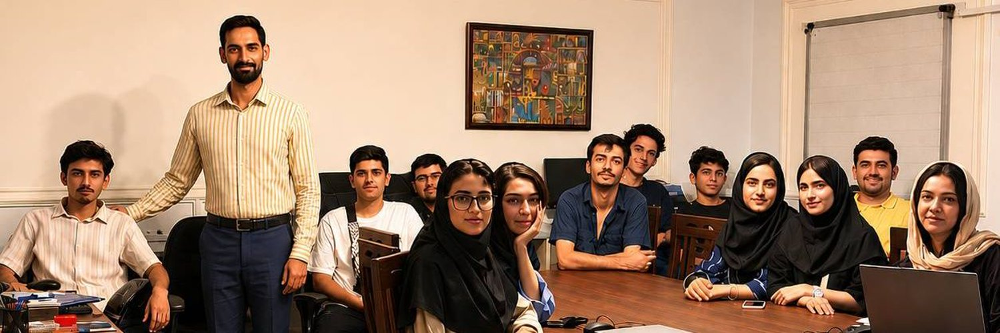
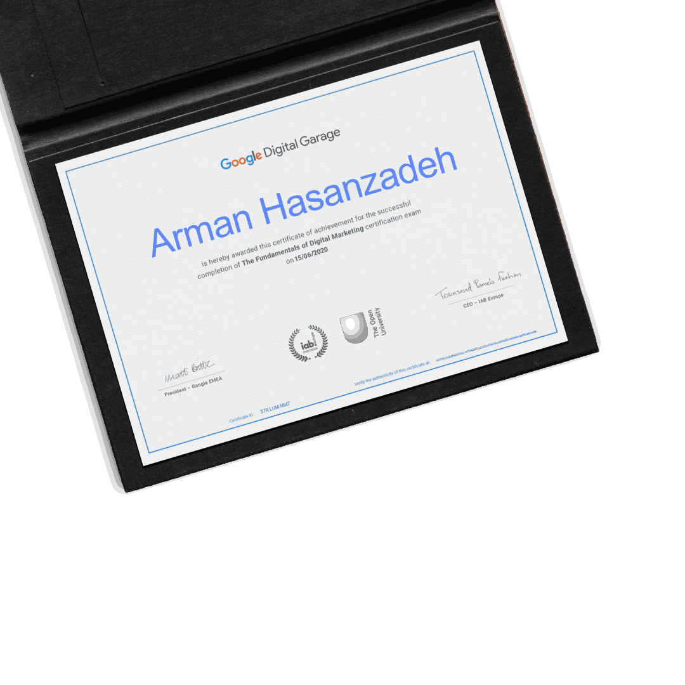

<!--
  Theme: dark + gold
  Accent: #F2A932 / #F2A93B
-->

# Arman Cursor

**Vibe Coder · Learning in public**

*Exploring product ideas with AI — one adventure at a time*

---

### About

I'm a **Vibe Coder**. When it comes to **programming languages**, I'm still a junior — early in the journey and learning as I go.

I build small products with AI tools like **Cursor** and **Claude Code**, pick up web and mobile basics project by project, and collect real experience without pretending to be a senior engineer.

I love the adventure of turning an idea into something that actually runs — even when I don't know every line of code yet.

Part of **[Charkhfalak Holding](https://charkhfalak.ir/)**.

---

### Contribution Snake

  <picture>
    <source
      media="(prefers-color-scheme: dark)"
      srcset="https://raw.githubusercontent.com/kel3o/kel3o/output/github-contribution-grid-snake-dark.svg"
    />
    <source
      media="(prefers-color-scheme: light)"
      srcset="https://raw.githubusercontent.com/kel3o/kel3o/output/github-contribution-grid-snake.svg"
    />
    
  </picture>

---

## 💻 Tech Stack

  

### 👨‍💻 Languages I'm learning

  

### 🌐 Web & Mobile

  

### 🛠 Tools I use

  

### 🚀 How I build

---

## ☁️ What I'm exploring

---

### Featured Projects

| Project | What it is |
|---------|------------|
| **[Arman-studio](https://github.com/kel3o/Arman-studio)** | A small Persian text-to-speech experiment using Gemini TTS |
| **[reel-studio](https://github.com/kel3o/reel-studio)** | Local Persian reel studio — teleprompter, multi-camera, timed cuts, editing & subtitles |

---

## 🎓 Certificates

### Google Digital Garage — Fundamentals of Digital Marketing
*Completed 15/06/2020 · Certificate ID: `37R LUM NM7`*

 

---

### Activity

---

### Profile Cat

A pixel cat that lives on this profile and reacts to my public GitHub activity.

<picture>
  <source media="(prefers-color-scheme: dark)" srcset="https://raw.githubusercontent.com/kel3o/kel3o/main/dist/pet.svg">
  <source media="(prefers-color-scheme: light)" srcset="https://raw.githubusercontent.com/kel3o/kel3o/main/dist/pet-light.svg">
  
</picture>

---

### Connect

- Website: [armanhasanzadeh.ir](https://armanhasanzadeh.ir/)
- Instagram: [@arman_cursor](https://www.instagram.com/arman_cursor)
- Telegram: [@arman_cursor](https://t.me/arman_cursor)
- LinkedIn: [Arman Hasanzade](https://www.linkedin.com/in/arman-hasanzade-b33285294)
- Company: [Charkhfalak Holding](https://charkhfalak.ir/)

⭐ Thanks for stopping by — I'm still learning, and the adventure continues.

